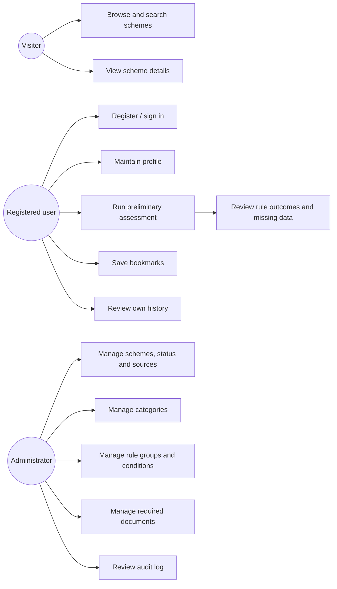
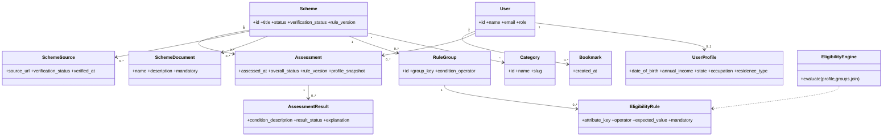
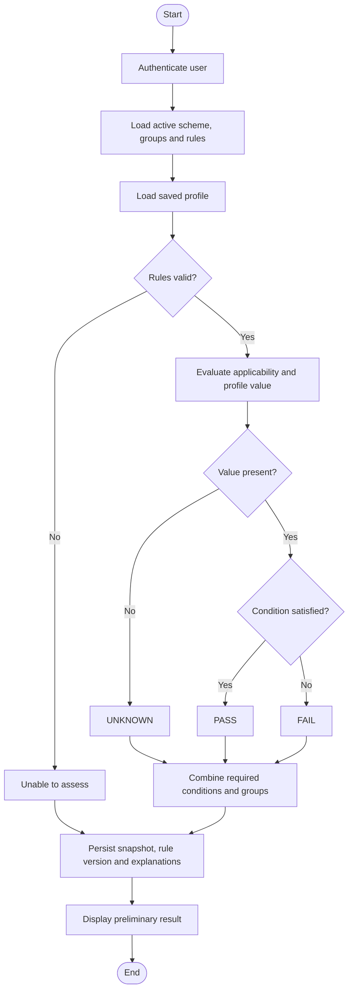
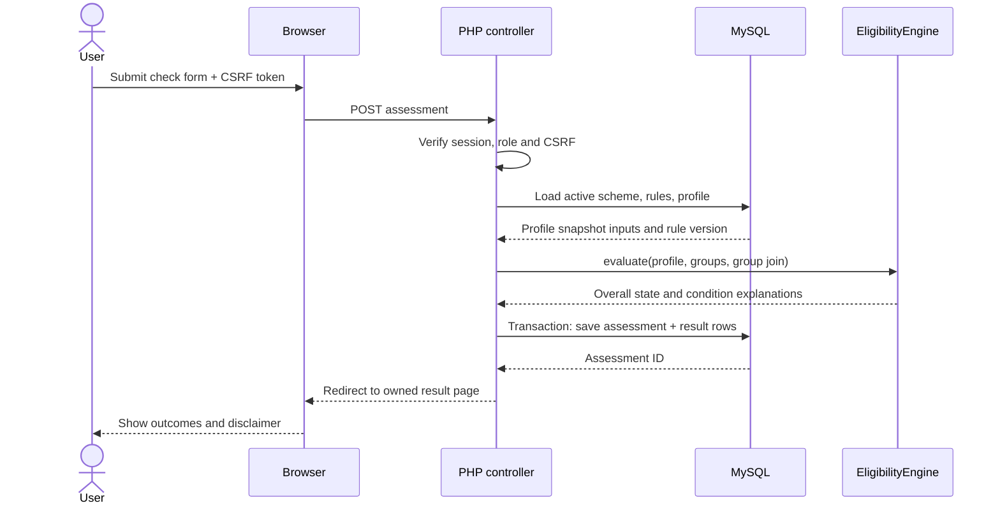
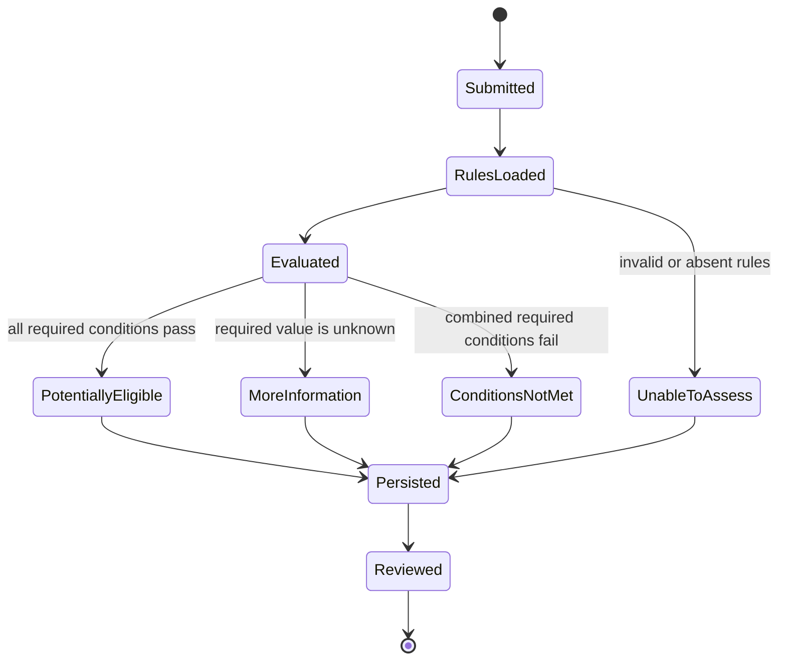
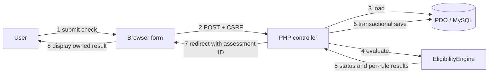
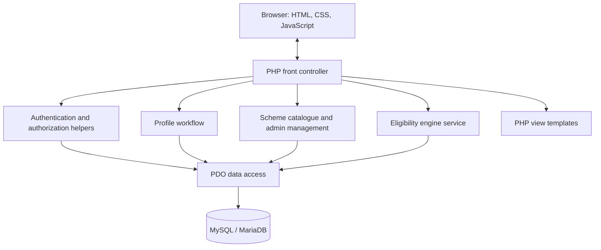
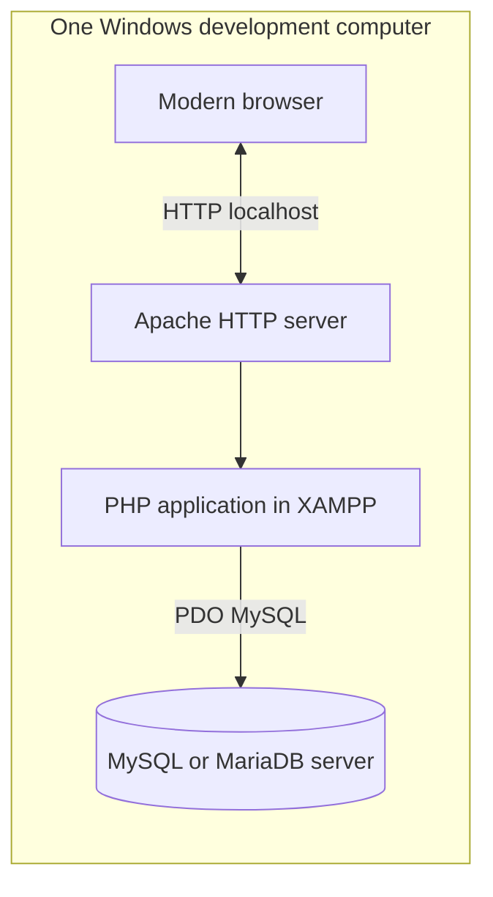

# SchemePath UML diagrams

## 1. Use-case diagram

## 2. Class diagram

## 3. Eligibility assessment activity

## 4. Eligibility check sequence

## 5. Assessment lifecycle state

## 6. Communication diagram

## 7. Component diagram

## 8. Deployment diagram

In the documented XAMPP setup, browser, Apache/PHP, and MySQL are separate logical nodes on the same physical computer.
